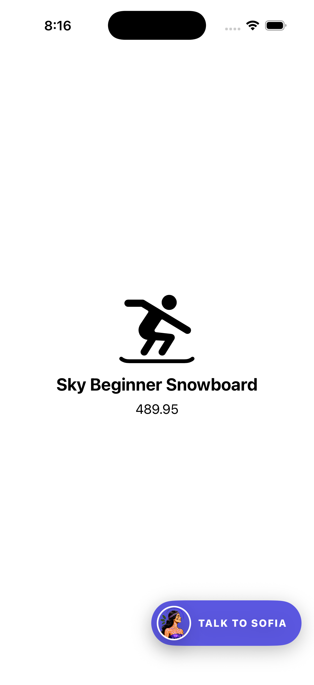
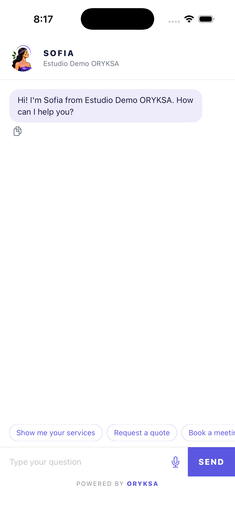
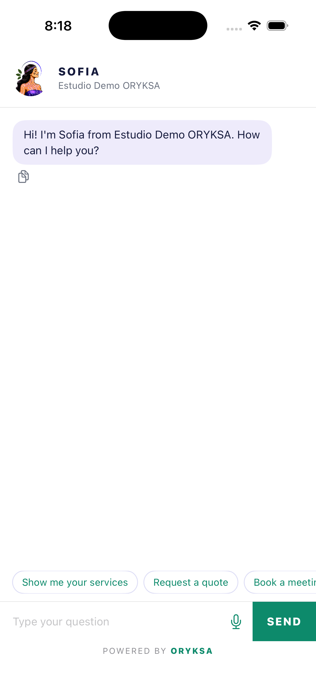
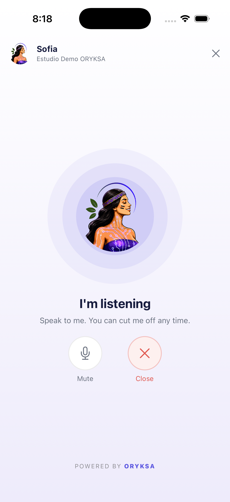

<p align="center"></p>

# ORYKSA for iOS (Swift)

[](README.md) [](README.pt.md) [](README.es.md) [](README.fr.md)

<p align="center"><a href="https://developer.oryksa.com/es/sdks"></a></p>

SDK oficial de Swift de **ORYKSA AI Employees**. Pon dentro de tu app iOS o macOS un empleado de IA que ya conoce tu negocio: un chat listo en SwiftUI (y UIKit) con el mismo aspecto que el chat de la web de ORYKSA, el nombre y la foto de tu IA desde tu cuenta ORYKSA, en inglés, portugués y español.

* Documentación: https://developer.oryksa.com/es/sdks
* API: `https://api.oryksa.com/v1`
* iOS 15 o superior, macOS 12 o superior, tvOS 15 o superior (el producto `OryksaTV`), sin dependencias.

## Capturas de pantalla

<p align="center">   </p>

Pantallas reales de la app de ejemplo de este repositorio, capturadas por el CI en un simulador con una cuenta de prueba de ORYKSA. El chat verde usa el código de *Colores y tema*, más abajo.

## Instalar (Swift Package Manager)

En Xcode: **File > Add Package Dependencies**, pega `https://github.com/oryksa/oryksa-swift` y elige la versión `1.2.0`. O en `Package.swift`:

```swift
.package(url: "https://github.com/oryksa/oryksa-swift", from: "1.2.0")
```

CocoaPods:

```ruby
pod 'Oryksa', :git => 'https://github.com/oryksa/oryksa-swift.git', :tag => '1.2.0'
```

## Para qué sirve

El SDK pone el chat y la voz de ORYKSA dentro de tu app para atender a los **clientes de tu negocio**: preguntan, compran y reservan. La IA responde con tu Brain, tus productos y tus servicios, con el nombre, la foto y la voz que elegiste en *Tu IA*, y guarda leads, reservas y ventas en las Actividades de tu cuenta ORYKSA. **No** es una interfaz para el dueño: a través del SDK nadie cambia ajustes, lee las Actividades ni da órdenes a ORYKSA. Más información: https://help.oryksa.com/es/a/sdks-what-they-do

Las palabrotas que escribe el cliente aparecen con asteriscos en el chat (la misma lista de todos los chats de ORYKSA, cargada desde `https://app.oryksa.com/widget/profanity.json` y guardada 24 horas). Las respuestas de la IA ya vienen filtradas desde el servidor.

## Voz y contexto de la app (1.1)

El chat muestra un micrófono cuando tu plan incluye voz. Abre la pantalla de voz con el mismo comportamiento que la app de ORYKSA: el micrófono sigue abierto mientras ella habla y solo una voz humana la interrumpe (el tecleo, la televisión y su propio eco no); se detiene en la palabra y el texto queda en el chat; a un susurro responde con un susurro; si su voz falla, se muestra el texto (nunca una voz robótica).

Permiso de micrófono: añade `NSMicrophoneUsageDescription` a Info.plist (la voz es solo para iOS).

```swift
OryksaChatButton(client: client, lang: "pt",
                 appContext: { OryksaAppContext(screen: "product", title: "Sky Beginner Snowboard, 489.95") })
```

## Enlaces con botón Abrir (1.1.3)

Los enlaces que da la IA se pueden tocar en el chat (direcciones web y e-mails), y cada enlace web tiene una tarjeta debajo de su respuesta con la foto y el título de la página y un botón **Abrir** (las páginas de tu propio sitio, los dominios de tu chat web; otros sitios muestran la dirección). La pantalla de voz muestra lo que ella dice sin las direcciones, con las mismas tarjetas; tocar Abrir cierra la pantalla de voz. Pasa `onLink` para abrir tus propias pantallas, por ejemplo la página del producto: devuelve true cuando tu app lo abrió, false para que lo abra el navegador.

```swift
OryksaChatButton(client: client, lang: "es", onLink: { url in
    guard let id = myProductId(url) else { return false } // tus rutas
    router.showProduct(id)
    return true
})
```

`onLink` también está en `OryksaChatView`, `OryksaChatViewController`, `OryksaVoiceView` y `OryksaVoiceSheet`. En iOS 15, tocar un enlace dentro del texto abre el navegador; el botón Abrir pasa por `onLink` en todas las versiones.

## Adjuntar una foto o un documento (1.1.3)

El chat tiene un botón de adjuntar (un clip, activado por defecto, iOS): una foto de la galería, una foto de la cámara o un documento (PDF, Word, texto, CSV, hasta 8 MB). La IA mira la foto (reducida a 1600 píxeles, JPEG, hasta 2 MB) y lee el documento; la burbuja del cliente muestra la foto, o el icono del documento y su nombre. `attachments: false` oculta el botón.

Permisos en Info.plist:

* `NSCameraUsageDescription` para la cámara. La opción Cámara solo aparece cuando existe esta clave, así la app nunca se cierra por no tenerla.
* `NSPhotoLibraryUsageDescription` no la necesita el SDK: la galería se abre en el selector del sistema (PHPicker), que no pide permiso. Añádela solo si tu app lee la galería por su cuenta.
* Los documentos se abren en el selector de documentos del sistema y no necesitan nada.

```xml
<key>NSCameraUsageDescription</key><string>Para enviar una foto a nuestro asistente.</string>
```

```swift
OryksaChatButton(client: client, lang: "es", attachments: false) // sin botón de adjuntar
// Sin la interfaz:
try await client.send("Aquí está el presupuesto", file: OryksaFile(data: pdf, name: "presupuesto.pdf", mime: "application/pdf"))
```

## Tus funciones de IA: `ai` (1.1.4)

Haz que la IA haga lo que tu app necesita (leer una foto, extraer datos, clasificar, traducir, escribir) y paga con interacciones ORYKSA, cobradas según la tabla de costes de interacción de ORYKSA: hoy 1 por respuesta en texto y 3 más por cada foto o documento leído; el trabajo pesado suma 1 cada 20 mil tokens. Tu prompt y tu JSON Schema viven en tu app; basta el token de sesión (nunca lleves la clave secreta). No crea una conversación en tu bandeja.

```swift
let r = try await client.ai(
    instructions: "Read the tyre on the photo: brand, model and size exactly as written on the sidewall. If the size is not legible, readable=false and size=null. Never invent.",
    images: [OryksaImage(data: jpeg)], // resized to 1600 px
    schema: ["type": "object",
             "properties": ["readable": ["type": "boolean"], "brand": ["type": ["string", "null"]], "size": ["type": ["string", "null"]]],
             "required": ["readable", "brand", "size"]])
if r.json?["readable"] as? Bool == true, let size = r.json?["size"] as? String { showProducts(for: size) }
```

`r.text` trae la respuesta en texto, `r.json` el objeto (con schema) y `r.interactionsSpent` las interacciones usadas. Cuando se agotan las interacciones del plan, la llamada lanza `OryksaError` con el status 402.

## Apps de Apple TV: `OryksaTV` (1.2)

Lo que la IA hace en cualquier app de Apple TV, solo con el mando Siri Remote (flechas, OK y Atrás), con letra grande y un foco que se ve desde el sofá. Es SwiftUI nativo con el motor de foco de tvOS, sin web view. Los textos, las voces, las reglas y los botones vienen de tu cuenta ORYKSA. Es un producto aparte, así que las apps de móvil no lo llevan (tvOS 15 o superior).

* **Presentadora**: la IA habla en pantalla con una voz nativa en el idioma de quien está mirando, con subtítulos grandes y su foto y su nombre desde tu cuenta. Las frases que ya dijo vuelven a sonar desde el dispositivo, sin generar una voz nueva, y se cobran otra vez cada vez que las dice.
* **Panel de asistente**: una conversación con la IA pensada para el mando, a pantalla completa o como panel lateral.
* **Voz por el móvil**: el Apple TV no da micrófono a las apps. La TV muestra un código QR, el móvil abre la página de ORYKSA y lo que dice la persona llega a tu app como texto.
* **`client.ai`** para tus propias tareas, por ejemplo moderar o clasificar.

```swift
// Package.swift: .product(name: "OryksaTV", package: "oryksa-swift")
import OryksaTV

@main
struct MiAppDeTV: App {
    // En el Apple TV el cliente envía el platform "tvos" por sí solo.
    @StateObject private var tv = OryksaTv(client: OryksaClient(getToken: { try await MiServidor.tokenOryksa() }),
                                           locale: "es-ES")
    @State private var mostrarAsistente = false

    var body: some Scene {
        WindowGroup {
            TuPantalla(alPedirAyuda: { mostrarAsistente = true })
                .oryksaTvPresenter(tv) // su foto, su nombre y los subtítulos; OK y Atrás la callan mientras habla
                .oryksaTvAssistant(isPresented: $mostrarAsistente, tv: tv)
                .task { await tv.presenter.say("¡Bienvenidos! Soy vuestra presentadora esta noche.") }
        }
    }
}

try await tv.presenter.sayGenerated(instructions: "Anuncia la próxima ronda en una frase corta.", input: "Ronda 2")
// Solo subtítulos, sin sonido (se cobra al precio de texto; una frase con voz se cobra al precio de voz).
await tv.presenter.say("El tema de esta noche: viajes.", voice: false)

// El móvil como micrófono: muestra OryksaPairingCard(tv: tv) y lee lo que se dice.
tv.phoneVoice.onText = { texto in cuandoElEspectadorDijo(texto) }
```

* **Sin servidor propio**: `OryksaTv.publicClient(chatToken:conversationId:)` abre una sesión pública con el token público del chat de tu negocio, y envía `platform: tvos` y el bundle id de tu app como `app_id`. Cuando tu negocio limita el chat, debe poner tu bundle id en la lista de apps permitidas. `app_id` es un filtro, no una seguridad fuerte (se puede imitar): la seguridad fuerte es que el token venga de tu propio servidor (`POST /v1/sessions`).
* **Idiomas**: el servidor de ORYKSA elige la voz y los textos para el locale. Hay voces nativas para pt-BR, pt-PT, es-ES, es-419, fr-FR, de-DE, en-US y en-GB, y los demás idiomas usan la voz de inglés de EE. UU.
* **Interacciones**: cada frase de la presentadora se cobra según la tabla de costes de interacción de ORYKSA cada vez que la dice o la muestra (por cada trozo de hasta 600 caracteres), también la frase repetida y la frase solo con subtítulos: la frase con voz al precio de voz y la frase solo con subtítulos al precio de texto. El número exacto viene en la cabecera `X-ORYKSA-Interactions-Spent`, y una frase que el servidor no contó no aparece (`onError` la recibe). Cada texto oído en el móvil, cada respuesta del chat y cada respuesta de `client.ai` también se cobran.
* **Mando**: OK, Play/Pausa y Atrás detienen a la presentadora mientras habla y no pasan a tu app. En el panel de asistente, arriba y abajo recorren los mensajes y los botones, izquierda y derecha van entre los botones, y Atrás lo cierra.
* **Micrófono de la TV**: `OryksaTvMic.isAvailable()` es falso en el Apple TV; el SDK nunca pide el micrófono allí.
* **Frases guardadas**: las voces que ya dijo quedan en la carpeta Caches de la app (tvOS puede vaciarla; entonces la voz se vuelve a generar).

* **Apps de iPhone y Mac (1.2)**: cada petición de chat envía ahora `platform` (`ios` por defecto), como hacen los SDK de Flutter y Android, y `OryksaClient.public(chatToken:..., platform:, appId:)` también abre allí una sesión pública. Para ellas no cambia nada más.
* **Probado** (28/11/2026, Xcode 27.2, simulador de Apple TV con tvOS 27.2): las pruebas unitarias en macOS y en el simulador de tvOS, la app de demostración y pruebas de interfaz con el mando Siri Remote: una frase nueva, la misma frase otra vez (guardada en el dispositivo) y una frase solo con subtítulos, contra el servidor real en una cuenta de prueba (cobradas 3, 3 y 1, la tabla de costes de ese día); OK y Atrás la callan y la tecla no pasa a la app. **No probado**: el sonido en sí (solo los bytes de la voz al llegar), el panel de asistente, el teclado del sistema, el QR del móvil, el cambio de idioma y un Apple TV físico.

Para pruebas y demostraciones, `OryksaTv(backend: OryksaTvFakeBackend())` lo ejecuta todo sin el servidor. Es simulado, así que no demuestra nada sobre tu cuenta ORYKSA. La app de demostración está en `ExampleTV/` (cómo compilarla, ejecutarla y probarla en el simulador de Apple TV: `TVOS-SIMULADOR.md`, en portugués).

## Cómo funciona (y por qué la clave está segura)

1. Tu **servidor** guarda la clave secreta de la API (`oryk_live_...`, creada en developer.oryksa.com) y crea un **token de sesión** de corta duración para cada usuario que ha iniciado sesión, con `POST /v1/sessions`.
2. Tu **app** recibe solo ese token de sesión (`oryk_cs_...`). La clave secreta nunca entra en la app.
3. Cada respuesta de la IA cuenta como una interacción de tu plan ORYKSA, igual que en WhatsApp.

## SwiftUI

```swift
import Oryksa

let client = OryksaClient(getToken: {
    try await MyBackend.fetchOryksaToken() // devuelve "oryk_cs_..."
})

struct ContentView: View {
    var body: some View {
        ZStack(alignment: .bottomTrailing) {
            MyScreens()
            OryksaChatButton(client: client, lang: "en").padding() // en, pt, br, es
        }
    }
}
```

Otras piezas: `OryksaChatView(client: client)` (el panel en cualquier lugar), `OryksaChatTheme` (colores) y, para UIKit, `present(OryksaChatViewController(client: client), animated: true)`.

Sin la interfaz: `try await client.agent()`, `try await client.sendAndWait("Are you open on Saturday?")`, `try await client.messages()`.

## Mantén la IA sincronizada con tu app

En tu servidor (por ejemplo con `@oryksa/sdk` en Node): `oryksa.learnApp({ name, description, screens, faq })`.

## Errores

Las llamadas que fallan lanzan `OryksaError` con `status`, `code` (por ejemplo `interaction_limit_reached`, `rate_limited`, `plan_required`) y `message`.

## Colores y tema

`OryksaChatTheme` tiene cinco colores: `accent` (botones, burbujas del visitante, enlaces), `ink` (texto principal), `soft` (burbujas de la IA), `background` (panel) y `muted` (texto secundario). Cada uno es un `Color` de SwiftUI y tiene un valor por defecto, así que solo pasas los que quieres cambiar.

```swift
let theme = OryksaChatTheme(accent: Color(red: 0.05, green: 0.54, blue: 0.42))

OryksaChatButton(client: client, lang: "en", theme: theme)
// or the panel: OryksaChatView(client: client, theme: theme)
// or UIKit: OryksaChatViewController(client: client, theme: theme)
```

No hay tema oscuro automático: para el modo oscuro, pasa tus propios colores oscuros.

---

## Sobre el autor

**Weslley Harakawa** - Fundador de ORYKSA AI. En Lisboa, Portugal. Especialidades: inteligencia artificial, desarrollo web y móvil, tokenización en blockchain. Formación: University of the People.

- LinkedIn: https://www.linkedin.com/in/weslleyharakawa/
- ORYKSA AI Employees: https://oryksa.com (X: https://x.com/oryksa, Instagram: https://www.instagram.com/oryksaai, YouTube: https://www.youtube.com/@ORYKSA)

---

MIT License · ORYKSA AI Employees · W8 Atlantic Unipessoal Lda
