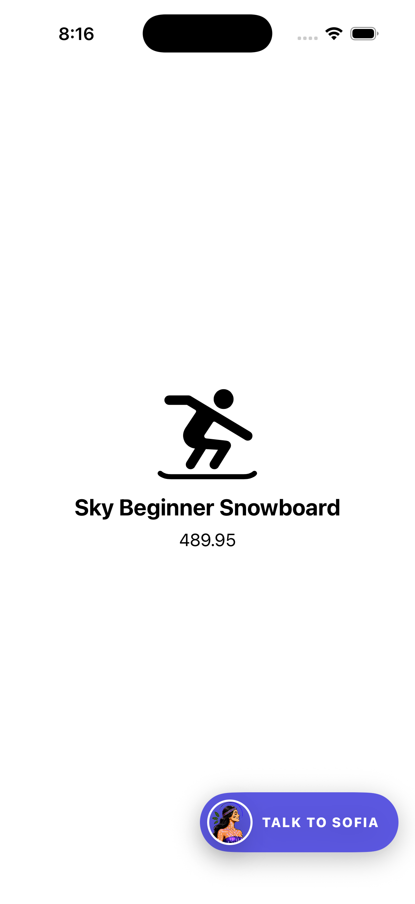
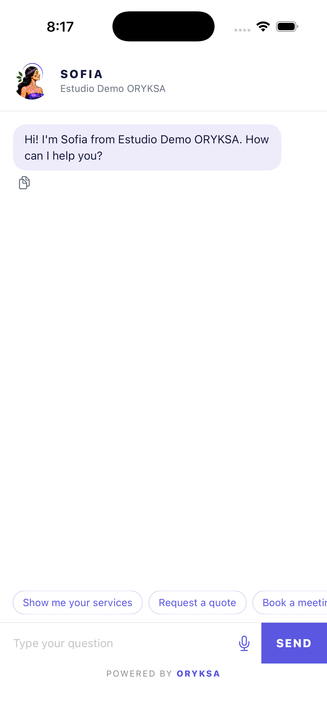
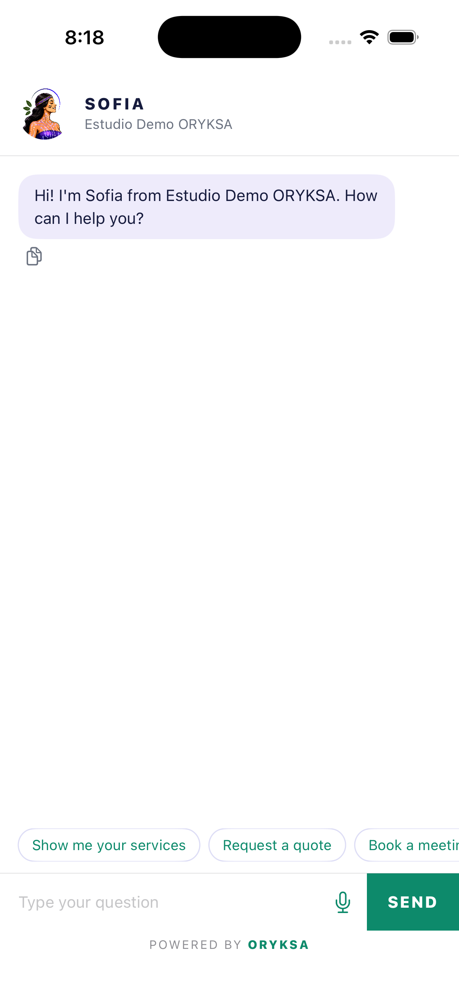
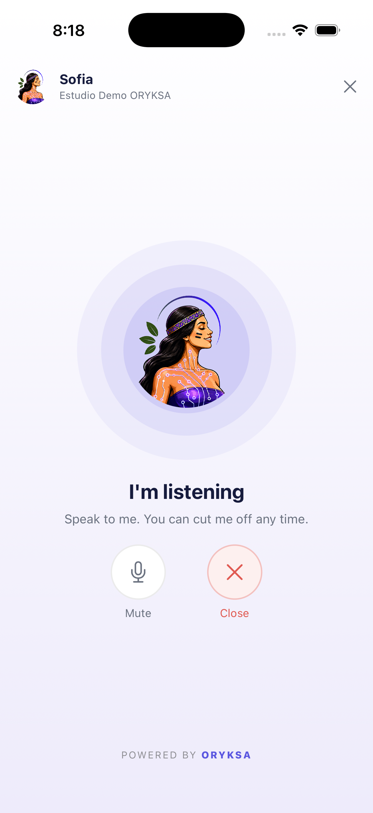

<p align="center"></p>

# ORYKSA for iOS (Swift)

[](README.md) [](README.pt.md) [](README.es.md) [](README.fr.md)

<p align="center"><a href="https://developer.oryksa.com/fr/sdks"></a></p>

SDK Swift officiel d'**ORYKSA AI Employees**. Mettez dans votre app iOS ou macOS un employé IA qui connaît déjà votre entreprise : un chat SwiftUI (et UIKit) prêt à l'emploi identique au chat du site ORYKSA, le nom et la photo de votre IA issus de votre compte ORYKSA, en anglais, portugais et espagnol.

* Documentation : https://developer.oryksa.com/fr/sdks
* API : `https://api.oryksa.com/v1`
* iOS 15+, macOS 12+, sans dépendances.

## Captures d'écran

<p align="center">   </p>

Écrans réels de l'app d'exemple de ce dépôt, capturés par la CI sur un simulateur avec un compte de test ORYKSA. Le chat vert utilise le code de *Couleurs et thème*, plus bas.

## Installer (Swift Package Manager)

Dans Xcode : **File > Add Package Dependencies**, collez `https://github.com/oryksa/oryksa-swift` et choisissez la version `1.1.3`. Ou dans `Package.swift` :

```swift
.package(url: "https://github.com/oryksa/oryksa-swift", from: "1.1.3")
```

CocoaPods :

```ruby
pod 'Oryksa', :git => 'https://github.com/oryksa/oryksa-swift.git', :tag => '1.1.3'
```

## À quoi il sert

Le SDK met le chat et la voix ORYKSA dans votre app pour servir les **clients de votre entreprise** : ils posent des questions, achètent et réservent. L'IA répond avec votre Brain, vos produits et vos services, avec le nom, la photo et la voix que vous avez choisis dans *Votre IA*, et enregistre les leads, réservations et ventes dans les Activités de votre compte ORYKSA. Ce n'est **pas** une interface pour le propriétaire : via le SDK, personne ne modifie les paramètres, ne lit les Activités ni ne donne d'ordres à ORYKSA. En savoir plus : https://help.oryksa.com/fr/a/sdks-what-they-do

Les gros mots que le client tape apparaissent sous forme d'astérisques dans le chat (la même liste que tous les chats ORYKSA, chargée depuis `https://app.oryksa.com/widget/profanity.json`, conservée 24 heures). Les réponses de l'IA arrivent déjà filtrées par le serveur.

## Voix et contexte de l'app (1.1)

Le chat affiche un micro quand votre forfait inclut la voix. Il ouvre l'écran vocal avec le même comportement que l'app ORYKSA : le micro reste ouvert pendant qu'elle parle et seule une voix humaine l'interrompt (la frappe au clavier, la télévision et son propre écho ne l'interrompent pas) ; elle s'arrête sur le mot et le texte reste dans le chat ; à un chuchotement, elle répond en chuchotant ; si sa voix échoue, le texte est affiché (jamais une voix robotique).

Autorisation du micro : ajoutez `NSMicrophoneUsageDescription` à Info.plist (la voix est disponible uniquement sur iOS).

```swift
OryksaChatButton(client: client, lang: "pt",
                 appContext: { OryksaAppContext(screen: "product", title: "Sky Beginner Snowboard, 489.95") })
```

## Liens avec un bouton pour les ouvrir (1.1.3)

Les liens que donne l'IA se touchent dans le chat (adresses web et e-mails), et chaque lien web a une carte sous sa réponse avec la photo et le titre de la page et un bouton pour l'ouvrir (les pages de votre propre site, les domaines de votre chat web ; les autres sites montrent l'adresse). L'écran vocal montre ce qu'elle dit sans les adresses, avec les mêmes cartes ; toucher le bouton ferme l'écran vocal. Passez `onLink` pour ouvrir vos propres écrans, par exemple la page du produit : renvoyez true quand votre app l'a ouvert, false pour laisser le navigateur l'ouvrir.

```swift
OryksaChatButton(client: client, lang: "en", onLink: { url in
    guard let id = myProductId(url) else { return false } // vos routes
    router.showProduct(id)
    return true
})
```

`onLink` existe aussi sur `OryksaChatView`, `OryksaChatViewController`, `OryksaVoiceView` et `OryksaVoiceSheet`. Sur iOS 15, toucher un lien dans le texte ouvre le navigateur ; le bouton passe par `onLink` sur toutes les versions.

## Joindre une photo ou un document (1.1.3)

Le chat a un bouton pour joindre (un trombone, activé par défaut, iOS) : une photo de la galerie, une photo de l'appareil photo ou un document (PDF, Word, texte, CSV, jusqu'à 8 Mo). L'IA regarde la photo (réduite à 1600 pixels, JPEG, jusqu'à 2 Mo) et lit le document ; la bulle du client montre la photo, ou l'icône du document et son nom. `attachments: false` masque le bouton.

Autorisations dans Info.plist :

* `NSCameraUsageDescription` pour l'appareil photo. L'option n'apparaît que lorsque cette clé existe, donc l'app ne se ferme jamais faute de l'avoir.
* `NSPhotoLibraryUsageDescription` n'est pas nécessaire au SDK : la galerie s'ouvre dans le sélecteur du système (PHPicker), qui ne demande pas d'autorisation. Ajoutez-la seulement si votre app lit la galerie elle-même.
* Les documents s'ouvrent dans le sélecteur de documents du système et ne demandent rien.

```xml
<key>NSCameraUsageDescription</key><string>Pour envoyer une photo à notre assistant.</string>
```

```swift
OryksaChatButton(client: client, lang: "en", attachments: false) // sans bouton pour joindre
// Sans l'interface :
try await client.send("Voici le devis", file: OryksaFile(data: pdf, name: "devis.pdf", mime: "application/pdf"))
```

## Comment ça marche (et pourquoi la clé reste en sécurité)

1. Votre **serveur** garde la clé API secrète (`oryk_live_...`, créée sur developer.oryksa.com) et crée un **jeton de session** de courte durée pour chaque utilisateur connecté avec `POST /v1/sessions`.
2. Votre **app** ne reçoit que ce jeton de session (`oryk_cs_...`). La clé secrète n'entre jamais dans l'app.
3. Chaque réponse de l'IA compte comme une interaction de votre forfait ORYKSA, comme sur WhatsApp.

## SwiftUI

```swift
import Oryksa

let client = OryksaClient(getToken: {
    try await MyBackend.fetchOryksaToken() // renvoie "oryk_cs_..."
})

struct ContentView: View {
    var body: some View {
        ZStack(alignment: .bottomTrailing) {
            MyScreens()
            OryksaChatButton(client: client, lang: "en").padding() // en, pt, br, es
        }
    }
}
```

Autres éléments : `OryksaChatView(client: client)` (le panneau n'importe où), `OryksaChatTheme` (couleurs), et pour UIKit `present(OryksaChatViewController(client: client), animated: true)`.

Sans l'interface : `try await client.agent()`, `try await client.sendAndWait("Are you open on Saturday?")`, `try await client.messages()`.

## Garder l'IA synchronisée avec votre app

Sur votre serveur (par exemple avec `@oryksa/sdk` sur Node) : `oryksa.learnApp({ name, description, screens, faq })`.

## Erreurs

Les appels qui échouent lèvent `OryksaError` avec `status`, `code` (par exemple `interaction_limit_reached`, `rate_limited`, `plan_required`) et `message`.

## Couleurs et thème

`OryksaChatTheme` a cinq couleurs : `accent` (boutons, bulles du visiteur, liens), `ink` (texte principal), `soft` (bulles de l'IA), `background` (panneau) et `muted` (texte secondaire). Chacune est une `Color` SwiftUI avec une valeur par défaut : vous ne passez que celles que vous voulez changer.

```swift
let theme = OryksaChatTheme(accent: Color(red: 0.05, green: 0.54, blue: 0.42))

OryksaChatButton(client: client, lang: "en", theme: theme)
// or the panel: OryksaChatView(client: client, theme: theme)
// or UIKit: OryksaChatViewController(client: client, theme: theme)
```

Il n'y a pas de thème sombre automatique : pour le mode sombre, passez vos propres couleurs sombres.

---

## À propos de l'auteur

**Weslley Harakawa** - Fondateur d'ORYKSA AI. À Lisbonne, Portugal. Spécialités : intelligence artificielle, développement web et mobile, tokenisation blockchain. Formation : University of the People.

- LinkedIn: https://www.linkedin.com/in/weslleyharakawa/
- ORYKSA AI Employees: https://oryksa.com (X: https://x.com/oryksa, Instagram: https://www.instagram.com/oryksaai, YouTube: https://www.youtube.com/@ORYKSA)

---

MIT License · ORYKSA AI Employees · W8 Atlantic Unipessoal Lda
