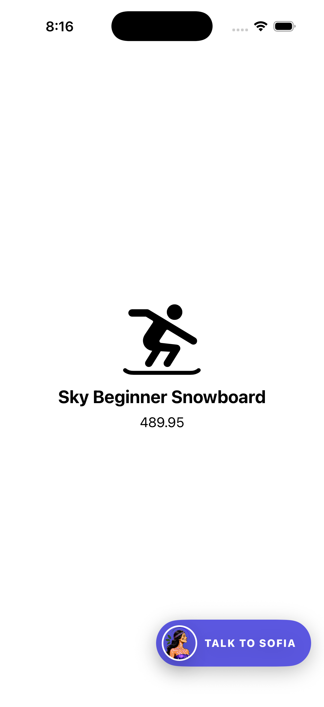
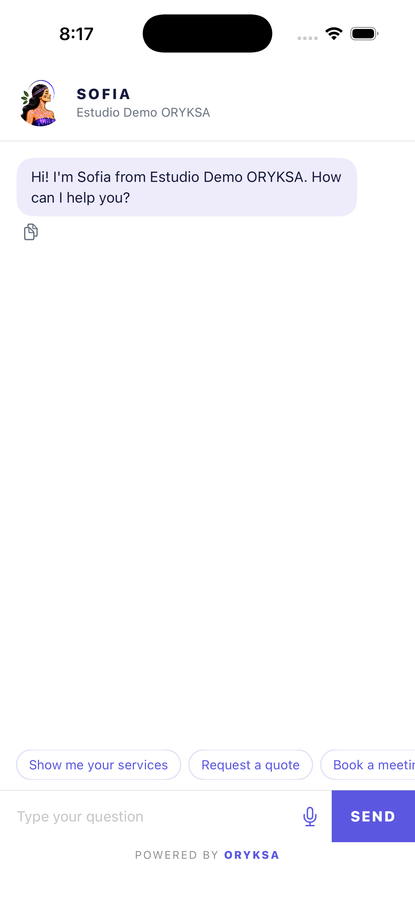
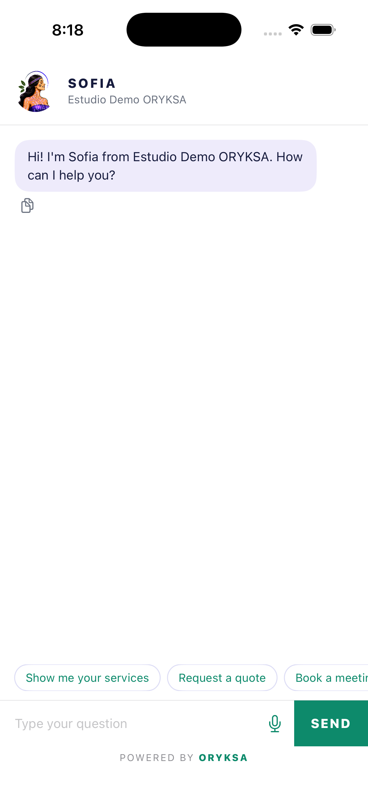
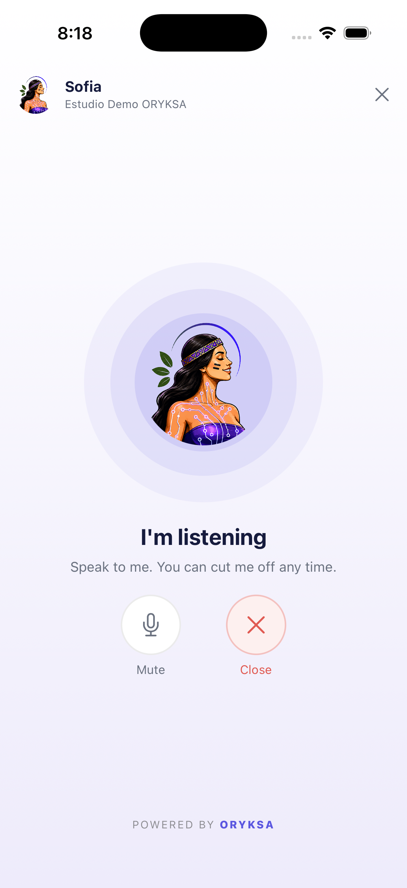

<p align="center"></p>

# ORYKSA for iOS (Swift)

[](README.md) [](README.pt.md) [](README.es.md) [](README.fr.md)

<p align="center"><a href="https://developer.oryksa.com/en/sdks"></a></p>

Official Swift SDK for **ORYKSA AI Employees**. Put an AI employee that already knows your business inside your iOS or macOS app: a ready SwiftUI (and UIKit) chat with the same look as the ORYKSA website chat, the name and photo of your AI from your ORYKSA account, in English, Portuguese and Spanish.

* Docs: https://developer.oryksa.com/en/sdks
* API: `https://api.oryksa.com/v1`
* iOS 15+, macOS 12+, no dependencies.

## Screenshots

<p align="center">   </p>

Real screens of the example app in this repository, taken by CI on a simulator with an ORYKSA test account. The green chat uses the code of *Colours and theme* below.

## Install (Swift Package Manager)

In Xcode: **File > Add Package Dependencies**, paste `https://github.com/oryksa/oryksa-swift` and pick version `1.0.0`. Or in `Package.swift`:

```swift
.package(url: "https://github.com/oryksa/oryksa-swift", from: "1.0.0")
```

CocoaPods:

```ruby
pod 'Oryksa', :git => 'https://github.com/oryksa/oryksa-swift.git', :tag => '1.0.0'
```

## What it is for

The SDK puts the ORYKSA chat and voice inside your app to serve the **customers of your business**: they ask, buy and book. The AI answers with your Brain, products and services, with the name, photo and voice you chose in *Your AI*, and saves leads, bookings and sales in the Activities of your ORYKSA account. It is **not** an interface for the owner: nobody changes settings, reads Activities or gives orders to ORYKSA through the SDK. More: https://help.oryksa.com/en/a/sdks-what-they-do

Swear words the customer types show as asterisks in the chat (the same list as every ORYKSA chat, loaded from `https://app.oryksa.com/widget/profanity.json`, kept 24 hours). The AI's replies already come filtered from the server.

## Voice and app context (1.1)

The chat shows a microphone when your plan has voice. It opens the voice screen with the same behaviour as the ORYKSA app: the microphone stays open while she speaks and only a human voice cuts her off (typing, TV and her own echo do not); she stops on the word and the text stays in the chat; a whisper gets a whispered answer; if her voice fails, the text is shown (never a robot voice).

Microphone permission: add `NSMicrophoneUsageDescription` to Info.plist (voice is iOS only).

```swift
OryksaChatButton(client: client, lang: "pt",
                 appContext: { OryksaAppContext(screen: "product", title: "Sky Beginner Snowboard, 489.95") })
```

## How it works (and why the key stays safe)

1. Your **server** keeps the secret API key (`oryk_live_...`, created at developer.oryksa.com) and creates a short-lived **session token** for each signed-in user with `POST /v1/sessions`.
2. Your **app** receives only that session token (`oryk_cs_...`). The secret key never goes into the app.
3. Every AI reply counts as one interaction of your ORYKSA plan, the same as on WhatsApp.

## SwiftUI

```swift
import Oryksa

let client = OryksaClient(getToken: {
    try await MyBackend.fetchOryksaToken() // returns "oryk_cs_..."
})

struct ContentView: View {
    var body: some View {
        ZStack(alignment: .bottomTrailing) {
            MyScreens()
            OryksaChatButton(client: client, lang: "en").padding() // en, pt, br, es
        }
    }
}
```

Other pieces: `OryksaChatView(client: client)` (the panel anywhere), `OryksaChatTheme` (colors), and for UIKit `present(OryksaChatViewController(client: client), animated: true)`.

Without the UI: `try await client.agent()`, `try await client.sendAndWait("Are you open on Saturday?")`, `try await client.messages()`.

## Keep the AI in sync with your app

On your server (for example with `@oryksa/sdk` on Node): `oryksa.learnApp({ name, description, screens, faq })`.

## Errors

Failed calls throw `OryksaError` with `status`, `code` (for example `interaction_limit_reached`, `rate_limited`, `plan_required`) and `message`.

## Colours and theme

`OryksaChatTheme` has five colors: `accent` (buttons, visitor bubbles, links), `ink` (main text), `soft` (AI bubbles), `background` (panel) and `muted` (secondary text). Every one is a SwiftUI `Color` and has a default, so you only pass the ones you want to change.

```swift
let theme = OryksaChatTheme(accent: Color(red: 0.05, green: 0.54, blue: 0.42))

OryksaChatButton(client: client, lang: "en", theme: theme)
// or the panel: OryksaChatView(client: client, theme: theme)
// or UIKit: OryksaChatViewController(client: client, theme: theme)
```

There is no automatic dark theme: for dark mode, pass your own dark colors.

---

## About the author

**Weslley Harakawa** - Founder of ORYKSA AI. Based in Lisbon, Portugal. Specialties: artificial intelligence, web and mobile development, blockchain tokenization. Education: University of the People.

- LinkedIn: https://www.linkedin.com/in/weslleyharakawa/
- ORYKSA AI Employees: https://oryksa.com (X: https://x.com/oryksa, Instagram: https://www.instagram.com/oryksaai, YouTube: https://www.youtube.com/@ORYKSA)

---

MIT License · ORYKSA AI Employees · W8 Atlantic Unipessoal Lda
