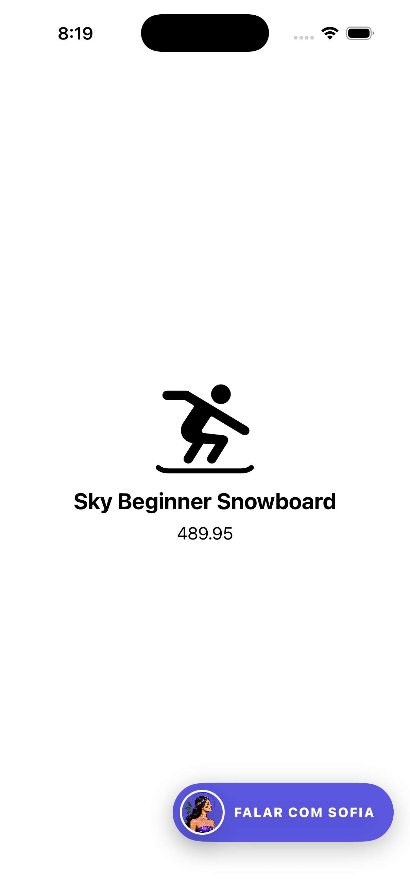
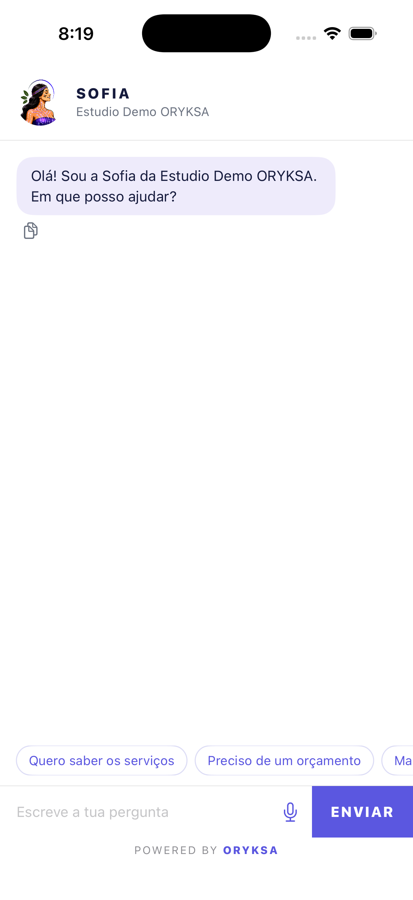
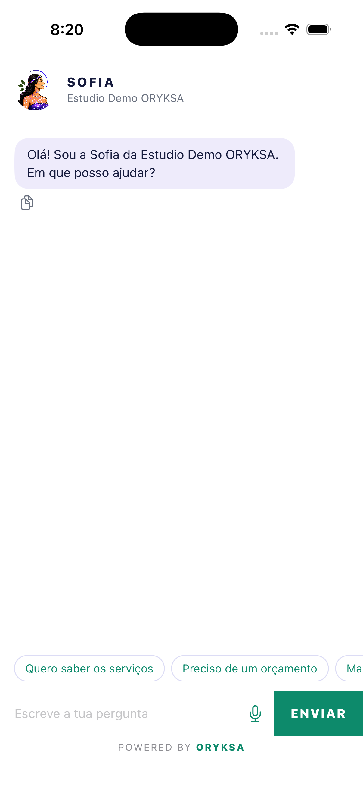
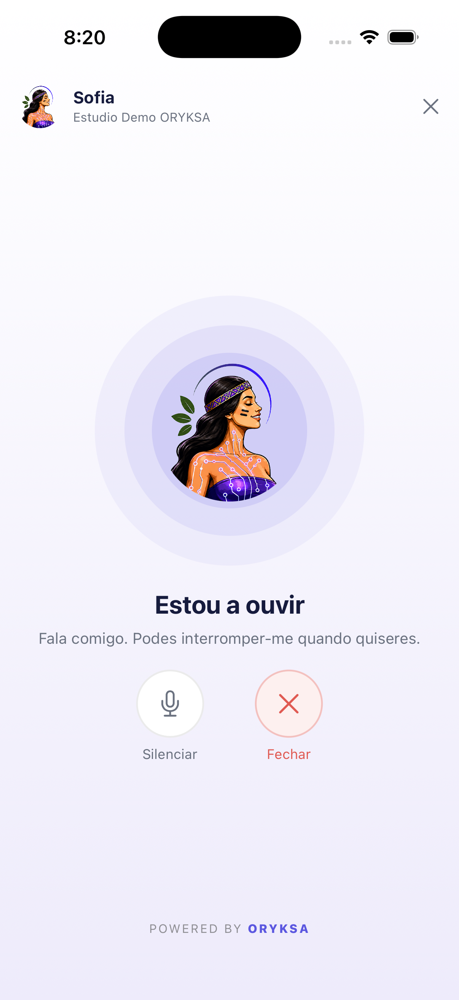

<p align="center"></p>

# ORYKSA for iOS (Swift)

[](README.md) [](README.pt.md) [](README.es.md) [](README.fr.md)

<p align="center"><a href="https://developer.oryksa.com/pt/sdks"></a></p>

SDK oficial Swift da **ORYKSA AI Employees**. Põe dentro da tua app iOS ou macOS um colaborador de IA que já conhece o teu negócio: um chat SwiftUI (e UIKit) pronto com o mesmo aspeto do chat do site da ORYKSA, o nome e a foto da tua IA vindos da tua conta ORYKSA, em inglês, português e espanhol.

* Documentação: https://developer.oryksa.com/pt/sdks
* API: `https://api.oryksa.com/v1`
* iOS 15+, macOS 12+, sem dependências.

## Capturas de ecrã

<p align="center">   </p>

Ecrãs reais da app de exemplo deste repositório, captados pelo CI num simulador com uma conta de teste da ORYKSA. O chat verde usa o código de *Cores e tema*, mais abaixo.

## Instalar (Swift Package Manager)

No Xcode: **File > Add Package Dependencies**, cola `https://github.com/oryksa/oryksa-swift` e escolhe a versão `1.1.5`. Ou no `Package.swift`:

```swift
.package(url: "https://github.com/oryksa/oryksa-swift", from: "1.1.5")
```

CocoaPods:

```ruby
pod 'Oryksa', :git => 'https://github.com/oryksa/oryksa-swift.git', :tag => '1.1.5'
```

## Para que serve

O SDK põe o chat e a voz da ORYKSA dentro da tua app para atender os **clientes do teu negócio**: eles perguntam, compram e marcam. A IA responde com o teu Brain, os teus produtos e serviços, com o nome, a foto e a voz que escolheste em *A tua IA*, e guarda leads, marcações e vendas nas Atividades da tua conta ORYKSA. **Não** é uma interface para o dono: ninguém altera definições, lê Atividades ou dá ordens à ORYKSA através do SDK. Mais: https://help.oryksa.com/pt/a/sdks-what-they-do

Os palavrões que o cliente escreve aparecem como asteriscos no chat (a mesma lista de todos os chats da ORYKSA, carregada de `https://app.oryksa.com/widget/profanity.json` e guardada durante 24 horas). As respostas da IA já vêm filtradas do servidor.

## Voz e contexto da app (1.1)

O chat mostra um microfone quando o teu plano tem voz. Abre o ecrã de voz com o mesmo comportamento da app ORYKSA: o microfone fica aberto enquanto ela fala e só uma voz humana a interrompe (escrever, a TV e o eco dela própria não); ela para na palavra e o texto fica no chat; um sussurro recebe uma resposta sussurrada; se a voz dela falhar, aparece o texto (nunca uma voz de robô).

Permissão do microfone: adiciona `NSMicrophoneUsageDescription` ao Info.plist (a voz é só para iOS).

```swift
OryksaChatButton(client: client, lang: "pt",
                 appContext: { OryksaAppContext(screen: "product", title: "Sky Beginner Snowboard, 489.95") })
```

## Links com botão Abrir (1.1.3)

Os links que a IA dá ficam clicáveis no chat (endereços web e e-mails), e cada link web ganha um cartão por baixo da resposta com a foto e o título da página e um botão **Abrir** (as páginas do teu próprio site, os domínios do teu chat do site; outros sites mostram o endereço). O ecrã de voz mostra o que ela diz sem os endereços, com os mesmos cartões; tocar em Abrir fecha o ecrã de voz. Passa `onLink` para abrir os teus próprios ecrãs, por exemplo a página do produto: devolve true quando a tua app o abriu, false para o navegador o abrir.

```swift
OryksaChatButton(client: client, lang: "pt", onLink: { url in
    guard let id = myProductId(url) else { return false } // as tuas rotas
    router.showProduct(id)
    return true
})
```

`onLink` também existe em `OryksaChatView`, `OryksaChatViewController`, `OryksaVoiceView` e `OryksaVoiceSheet`. No iOS 15, tocar num link dentro do texto abre o navegador; o botão Abrir passa por `onLink` em todas as versões.

## Anexar uma foto ou um documento (1.1.3)

O chat tem um botão de anexar (um clipe, ligado por omissão, iOS): uma foto da galeria, uma foto da câmara ou um documento (PDF, Word, texto, CSV, até 8 MB). A IA vê a foto (reduzida a 1600 píxeis, JPEG, até 2 MB) e lê o documento; o balão do cliente mostra a foto, ou o ícone do documento e o nome. `attachments: false` esconde o botão.

Permissões no Info.plist:

* `NSCameraUsageDescription` para a câmara. A opção Câmara só aparece quando esta chave existe, por isso a app nunca fecha por falta dela.
* `NSPhotoLibraryUsageDescription` não é precisa para o SDK: a galeria abre no seletor do sistema (PHPicker), que não pede permissão. Adiciona-a só se a tua app ler a galeria por si.
* Os documentos abrem no seletor de documentos do sistema e não precisam de nada.

```xml
<key>NSCameraUsageDescription</key><string>Para enviar uma foto ao nosso assistente.</string>
```

```swift
OryksaChatButton(client: client, lang: "pt", attachments: false) // sem botão de anexar
// Sem a interface:
try await client.send("Aqui está o orçamento", file: OryksaFile(data: pdf, name: "orcamento.pdf", mime: "application/pdf"))
```

## As tuas funções de IA: `ai` (1.1.4)

Põe a IA a fazer o que a tua app precisa (ler uma foto, extrair dados, classificar, traduzir, escrever) e paga com interações ORYKSA: 1 por resposta. O teu prompt e o teu JSON Schema ficam na tua app; basta o token de sessão (nunca leves a chave secreta). Não cria conversa na tua caixa.

```swift
let r = try await client.ai(
    instructions: "Read the tyre on the photo: brand, model and size exactly as written on the sidewall. If the size is not legible, readable=false and size=null. Never invent.",
    images: [OryksaImage(data: jpeg)], // resized to 1600 px
    schema: ["type": "object",
             "properties": ["readable": ["type": "boolean"], "brand": ["type": ["string", "null"]], "size": ["type": ["string", "null"]]],
             "required": ["readable", "brand", "size"]])
if r.json?["readable"] as? Bool == true, let size = r.json?["size"] as? String { showProducts(for: size) }
```

`r.text` tem a resposta em texto, `r.json` o objeto (com schema) e `r.interactionsSpent` as interações gastas. Quando as interações do plano acabam, a chamada lança `OryksaError` com o status 402.

## Como funciona (e porque é que a chave fica segura)

1. O teu **servidor** guarda a chave secreta da API (`oryk_live_...`, criada em developer.oryksa.com) e cria um **token de sessão** de curta duração para cada utilizador com sessão iniciada, com `POST /v1/sessions`.
2. A tua **app** recebe só esse token de sessão (`oryk_cs_...`). A chave secreta nunca entra na app.
3. Cada resposta da IA conta como uma interação do teu plano ORYKSA, tal como no WhatsApp.

## SwiftUI

```swift
import Oryksa

let client = OryksaClient(getToken: {
    try await MyBackend.fetchOryksaToken() // devolve "oryk_cs_..."
})

struct ContentView: View {
    var body: some View {
        ZStack(alignment: .bottomTrailing) {
            MyScreens()
            OryksaChatButton(client: client, lang: "en").padding() // en, pt, br, es
        }
    }
}
```

Outras peças: `OryksaChatView(client: client)` (o painel em qualquer sítio), `OryksaChatTheme` (cores) e, para UIKit, `present(OryksaChatViewController(client: client), animated: true)`.

Sem a interface: `try await client.agent()`, `try await client.sendAndWait("Are you open on Saturday?")`, `try await client.messages()`.

## Mantém a IA sincronizada com a tua app

No teu servidor (por exemplo com `@oryksa/sdk` em Node): `oryksa.learnApp({ name, description, screens, faq })`.

## Erros

As chamadas falhadas lançam `OryksaError` com `status`, `code` (por exemplo `interaction_limit_reached`, `rate_limited`, `plan_required`) e `message`.

## Cores e tema

O `OryksaChatTheme` tem cinco cores: `accent` (botões, balões do visitante, ligações), `ink` (texto principal), `soft` (balões da IA), `background` (painel) e `muted` (texto secundário). Cada uma é uma `Color` do SwiftUI e tem um valor por omissão, por isso só passas as que queres mudar.

```swift
let theme = OryksaChatTheme(accent: Color(red: 0.05, green: 0.54, blue: 0.42))

OryksaChatButton(client: client, lang: "en", theme: theme)
// or the panel: OryksaChatView(client: client, theme: theme)
// or UIKit: OryksaChatViewController(client: client, theme: theme)
```

Não há tema escuro automático: para o modo escuro, passa as tuas próprias cores escuras.

---

## Sobre o autor

**Weslley Harakawa** - Fundador da ORYKSA AI. Em Lisboa, Portugal. Especialidades: inteligência artificial, desenvolvimento web e mobile, tokenização em blockchain. Formação: University of the People.

- LinkedIn: https://www.linkedin.com/in/weslleyharakawa/
- ORYKSA AI Employees: https://oryksa.com (X: https://x.com/oryksa, Instagram: https://www.instagram.com/oryksaai, YouTube: https://www.youtube.com/@ORYKSA)

---

MIT License · ORYKSA AI Employees · W8 Atlantic Unipessoal Lda
